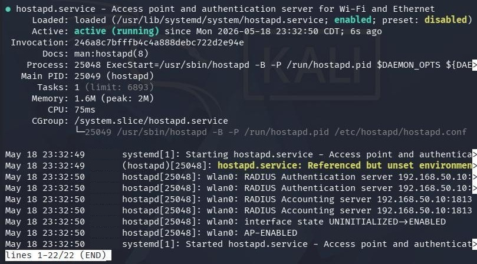
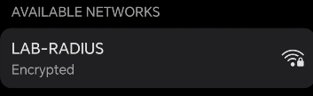

# WPA2-Enterprise RADIUS Lab

Laboratorio académico de autenticación inalámbrica con **WPA2-Enterprise**, **802.1X/PEAP-MSCHAPv2**, Windows Server 2022 (Active Directory y NPS), Kali Linux, `hostapd`, `dnsmasq` y un adaptador USB Atheros AR9271.

> Este repositorio documenta el diseño y los resultados observados. El punto de acceso llegó a iniciar (`wlan0: AP-ENABLED`) y el SSID `LAB-RADIUS` se observó como cifrado. La autenticación final del cliente no se confirmó: el passthrough USB del AR9271 hacia la VM Kali fue inestable. Ver la sección [Limitaciones y resultado](#limitaciones-y-resultado).

## Arquitectura

```text
Cliente Wi-Fi
    │  WPA2-Enterprise / 802.1X (EAPOL)
    ▼
Kali Linux + hostapd + AR9271
    │  RADIUS Access-Request / UDP 1812
    │  RADIUS Accounting       / UDP 1813
    ▼
Windows Server 2022 + NPS ─── Active Directory (`lab.local`)
```

VMware Workstation conecta Kali y Windows Server a una red Host-only para el tráfico de administración y RADIUS. El adaptador AR9271 se asigna a Kali por USB passthrough y proporciona la interfaz inalámbrica del punto de acceso. La interfaz Wi-Fi y la red VMnet son segmentos distintos; el ejemplo de `dnsmasq` usa una subred Wi-Fi separada.

| Componente | Función |
| --- | --- |
| Windows Server 2022 | Active Directory y Network Policy Server (NPS). |
| Kali Linux | Cliente RADIUS, punto de acceso `hostapd` y DHCP/DNS `dnsmasq`. |
| `hostapd` | Anuncia el SSID y realiza la autenticación 802.1X/PEAP, delegando la validación en NPS. |
| NPS | Valida las credenciales de dominio y responde a las solicitudes RADIUS. |
| `dnsmasq` | Asigna parámetros IP a clientes inalámbricos. |
| AR9271 | Adaptador USB usado para crear el punto de acceso; su transferencia a la VM limitó las pruebas. |

Las direcciones de los archivos de ejemplo son **marcadores de una red de laboratorio**. Ajústalas a tu topología y separa la subred inalámbrica de la subred Host-only.

## Flujo de autenticación

1. El cliente ve `LAB-RADIUS` y solicita acceso mediante 802.1X/EAPOL.
2. `hostapd` transporta la autenticación EAP (PEAP con MS-CHAPv2) a NPS usando RADIUS/UDP 1812.
3. NPS consulta Active Directory y aplica la política de red Wi-Fi al grupo permitido.
4. NPS devuelve aceptación o rechazo; si la autenticación se completa, `hostapd` permite el acceso inalámbrico.
5. La contabilidad RADIUS puede enviarse por UDP 1813. `dnsmasq` ofrece DHCP/DNS una vez disponible la asociación Wi-Fi.

El secreto compartido de RADIUS debe coincidir en NPS y `hostapd`. Los marcadores incluidos no son credenciales válidas; cámbialos por un secreto aleatorio fuera del control de versiones. No reutilices las credenciales de demostración que aparecen en la guía original.

## Archivos

- [`configs/hostapd.conf`](configs/hostapd.conf): plantilla WPA2-Enterprise/PEAP con NPS en UDP 1812 y contabilidad en UDP 1813.
- [`configs/dnsmasq.conf`](configs/dnsmasq.conf): plantilla de DHCP/DNS para un segmento Wi-Fi dedicado.
- [`assets/hostapd-ap-enabled.jpg`](assets/hostapd-ap-enabled.jpg): evidencia del servicio activo y `wlan0: AP-ENABLED`; se recortó el prompt interactivo del terminal.
- [`assets/lab-radius-encrypted.png`](assets/lab-radius-encrypted.png): `LAB-RADIUS` visible como red cifrada. El recorte omite otras redes cercanas.

## Configuración

1. Reserva una subred para VMnet/administración y otra distinta para clientes Wi-Fi. Asegura el enrutamiento necesario entre Kali, NPS y los clientes.
2. En NPS, registra el servidor en Active Directory, crea a Kali como cliente RADIUS usando la IP de su interfaz VMnet y configura una política que permita el grupo deseado con PEAP/MS-CHAPv2.
3. Copia `configs/hostapd.conf` a `/etc/hostapd/hostapd.conf`; reemplaza `RADIUS_SERVER_IP`, `KALI_VMNET_IP` y `REPLACE_WITH_A_LONG_RANDOM_SECRET`.
4. Configura la interfaz Wi-Fi con la IP de puerta de enlace que elijas para el segmento inalámbrico. Ajusta el rango DHCP/DNS de `configs/dnsmasq.conf` a la misma subred.
5. Habilita y reinicia `hostapd` y `dnsmasq`. Revisa `systemctl status hostapd`, `journalctl -u hostapd` y los eventos de NPS (por ejemplo, aceptaciones/rechazos de autenticación) para validar cada etapa.
6. Confirma que la tarjeta y el controlador soporten modo AP y que VMware haya conectado el dispositivo USB a Kali, no al host.

Los fragmentos son plantillas ilustrativas: valida la sintaxis y compatibilidad de las opciones con las versiones instaladas antes de usarlos.

## Hallazgos y evidencias

- Se observó `hostapd` activo y el registro `wlan0: AP-ENABLED`, lo que demuestra que el AP pudo iniciar en esa ejecución.
- En una captura separada, el SSID `LAB-RADIUS` aparece como **Encrypted**. Esto confirma que era visible y anunciaba seguridad; **no demuestra una autenticación exitosa**.
- La conexión del cliente no se completó de forma concluyente. El passthrough USB del AR9271 a la máquina virtual tuvo comportamiento inestable y fue la limitación principal de la demostración.
- La guía fuente también contiene una captura del teléfono conectado a otra red; se excluyó del repositorio para evitar presentarla como una conexión exitosa al laboratorio.

### Capturas seleccionadas



*El punto de acceso inició; la captura no acredita la autenticación de un cliente.*



*La red aparece disponible y cifrada; el dispositivo seguía conectado a otra red, por lo que no se afirma que se haya conectado a LAB-RADIUS.*

## Limitaciones y resultado

La demostración valida la preparación de AD/NPS y la activación del AP en el entorno registrado, pero no acredita de extremo a extremo que un cliente se haya autenticado correctamente ni que recibiera una concesión DHCP de `dnsmasq`. La foto del cliente muestra `LAB-RADIUS` en redes disponibles como cifrada mientras el teléfono permanece conectado a otra red. El adaptador AR9271/USB passthrough no proporcionó una base estable para completar esa prueba dentro de VMware.

Como siguiente paso, repetir con passthrough USB estable o con un AP físico compatible; luego validar el intercambio Access-Request/Access-Accept en NPS, la asociación del cliente y la concesión DHCP. No declarar el flujo completo como probado hasta observar esas evidencias.

## Seguridad y privacidad

- No se publican contraseñas de administrador, cuentas de dominio ni el secreto compartido usado en el laboratorio.
- Los archivos de configuración usan marcadores para secretos y direcciones sensibles.
- Usa cuentas de laboratorio sin privilegios y contraseñas únicas. Cambia los marcadores antes de ejecutar; no guardes secretos en Git.
- Mantén el laboratorio aislado y no habilites acceso público ni reenvío de puertos hacia NPS o el punto de acceso.

## Referencias

- IEEE 802.1X, control de acceso a redes basado en puertos.
- IETF [RFC 2865](https://www.rfc-editor.org/rfc/rfc2865), RADIUS.
- IETF [RFC 2866](https://www.rfc-editor.org/rfc/rfc2866), RADIUS Accounting.
- [Microsoft Learn: Network Policy Server](https://learn.microsoft.com/windows-server/networking/technologies/nps/nps-top).
- [hostapd](https://w1.fi/hostapd/).
- [dnsmasq](https://thekelleys.org.uk/dnsmasq/doc.html).


